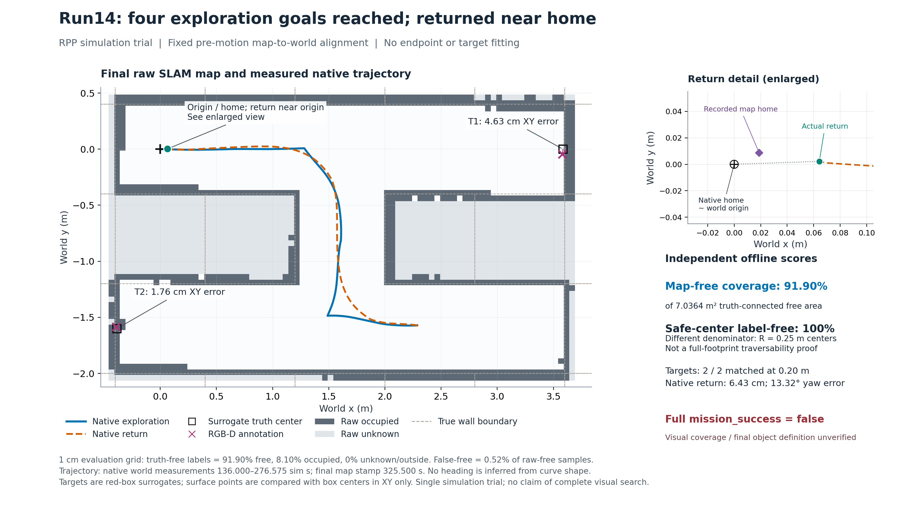
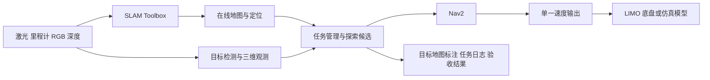

# LIMO 未知迷宫多目标搜索

课程项目：使用 ROS2 驱动 LIMO，在现场搭建的未知环境中自主探索和建图，搜索数量与位置均未知的目标，在地图上标注已确认目标，完成后返回起点。无需拿取物品。

本仓库用于源代码、配置、实验方案、每周分工及验证记录的版本管理。复用 SLAM Toolbox、Nav2 和已有 LIMO 模型，将新增工作集中在自主任务调度、视觉确认、目标标注和验收。

开发环境按已确认的 WSL Ubuntu 24.04 配置 ROS2 Jazzy 与 Gazebo Harmonic；实车的 ROS2 发行版、相机和目标定义仍待确认。

当前已完成 WSL 环境与 ROS 集成。run14 首次在 Gazebo 物理仿真中完成四次自主探索、两个红色替身的地图标注和返航；独立实际返航误差约 6.4 cm，两目标平面标注误差约 4.6/1.8 cm。视觉搜索覆盖和正式物品类别尚未验证，因此完整 `mission_success` 仍为 false，实车实验尚未通过。通过本轮的 RPP 与小迷宫 SLAM 配置作为可选实验配置保存，详见 [run14 记录](docs/autonomous-run14.md)和[复现步骤](docs/rpp-smoke-reproduction.md)。



## 项目入口

| 内容 | 入口 |
|---|---|
| PPT 要求及范围 | [课程要求](docs/course-requirements.md) |
| 现有实现、仓库版本与兼容性 | [上游审计](docs/upstream-audit.md) |
| 确认实车系统、ROS 和传感器 | [只读环境采集](docs/hardware-inventory.md) |
| 探索、识别、返航设计 | [探索与感知方案](docs/exploration-perception.md) |
| 实验矩阵与完成标准 | [实验验收](docs/experiment-plan.md) |
| ROS2 / Gazebo 接入 | [Jazzy 仿真](docs/jazzy-simulation.md) |
| 打开三维场景、地图和相机窗口 | [Gazebo / RViz 可视化](docs/visualization.md) |
| ROS2 任务管理 | [任务节点](docs/ros2-mission.md) |
| RGB-D 仿真视觉替身 | [感知基线](docs/perception-baseline.md) |
| 有效空检测、拒收与采样帧证据 | [图像处理证据](docs/frame-processing-evidence.md) |
| 到达后停稳并等待新处理帧 | [可选自主观察等待](docs/settled-inspection.md) |
| 实际验证状态 | [验证报告](docs/validation.md) |
| 首次真实平移、扩图与目标标注 | [run10 自主实验](docs/first-autonomous-run.md) |
| 两目标评分、到达裕量与返航停滞 | [run11 自主实验](docs/autonomous-run11.md) |
| 末端旋转超时与 SLAM 定位跳变 | [run12 自主实验](docs/autonomous-run12.md) |
| 预测路径、近目标停滞与净空保护 | [run13 自主实验](docs/autonomous-run13.md) |
| 首次探索、替身标注和返航 | [run14 自主实验](docs/autonomous-run14.md) |
| 新图像观察验证与到位超差诊断 | [run15 实验及保留的失败证据](docs/autonomous-run15.md) |
| 可选 RPP 小迷宫配置与运行顺序 | [复现步骤](docs/rpp-smoke-reproduction.md) |
| 车体真实运动与接触近似 | [物理验证](docs/physics-validation.md) |
| 激光输入与时间对照 | [只读扫描诊断](docs/scan-alignment.md) |
| 当前 SLAM 错位调查 | [旋转建图对照](docs/slam-rotation-investigation.md) |
| 固定输入的真实 SLAM 对照 | [隔离回放](docs/slam-replay.md) |
| 连续 TF、全局路径和速度链证据 | [仿真任务观察器](docs/mission-observer.md) |
| 地图最大边界缺墙修补 | [边界补丁及独立构建](docs/slam-grid-boundary.md) |
| 完整搜索尚缺什么 | [验收差距](docs/acceptance-gaps.md) |
| 分工与周报 | [周报模板](progress/weekly-template.md) |

## 立即运行二维逻辑仿真

Python 3.10 及以上，无第三方依赖，从仓库根目录执行：

```bash
python -m unittest discover -s tests -p test_sim.py -v
python -m sim.suite
python -m sim.run --seed 7 --target-count 3 --policy explore_then_return --output outputs/simulation/seed7
```

打开 `outputs/simulation/suite/index.html` 查看汇总，进入单例的 HTML 回放。每次运行生成 `run.json`、目标标注图和 `maze.txt`。`--target-count` 只配置仿真世界，不传入机器人策略；隐藏真值仅供离线评分。

二维仿真假定精确位姿、静态格网和理想局部观测，不是 SLAM 或物理仿真。机器人只按已观测自由空间规划，分别维护几何覆盖和理想语义搜索覆盖。默认完整模式发现目标后继续探索，结束后返航；`find_then_return` 仅是对照，不能满足课程要求。不可达区域、缺席目标和预算返航有独立结果。

## Jazzy 和 Harmonic 环境

安装脚本仅支持 Ubuntu 24.04，使用官方 ROS apt 源及校验过的源配置包：

```bash
sudo bash tools/setup_jazzy.sh
bash scripts/fetch_sim_vendor.sh
/usr/bin/python3 tools/configure_nav2.py
source /opt/ros/jazzy/setup.bash
colcon build --base-paths src vendor/hunter_gazebo/src/limo_base
source scripts/env.sh
```

如果终端处于 Conda 环境，先退出 Conda 再构建，使用系统 `/usr/bin/python3`。`scripts/env.sh` 为仿真使用本机发现范围和独立 ROS domain 73，不修改 shell 启动文件。实车连接需在确认网络、发行版及驱动后单独配置。

第一终端启动模型与迷宫：

```bash
source scripts/env.sh
ros2 launch limo_sim_bringup sim.launch.py world:="$PWD/worlds/smoke_maze.world"
```

第二终端启动实时建图和导航：

当前系统 SLAM 2.8.5 存在最大边界漏墙问题。先按[边界补丁说明](docs/slam-grid-boundary.md)构建独立 overlay，再在导航终端显式加载；不要把原版运行记为补丁验证。

```bash
source scripts/env.sh
source outputs/slam-boundary-ws/install/local_setup.bash
ros2 launch limo_maze_bringup mapping_navigation.launch.py
```

`smoke_maze` 的通道为 0.8 m，用于首轮集成；`example_maze` 保留 0.6 m 窄通道压力场景。两者都不提供地图或目标清单给机器人。默认 240° 扫描保留本模型的有效前向视场；360° 实验出现车身自回波，不能用它消除后方盲区。

传感器及 Nav2 就绪后，还须检查起始 footprint 是否处于已观测自由区，再按任务节点文档显式启用 `autonomous:=true`。初版红色 RGB-D 检测只验证模拟视觉管线；正式物品类别未确定，不能将红盒检测通过记为课程目标识别完成。

启动后可在第三终端运行只读接口检查；它们不会发送运动指令：

```bash
source scripts/env.sh
/usr/bin/python3 scripts/check_sim_runtime.py
/usr/bin/python3 scripts/check_navigation_runtime.py
```

建图启动文件为每次新会话生成 `/mission/map_epoch`。不要在任务运行中直接调用 SLAM reset/reload；先停止旧任务，再用新会话重启。地图和目标 JSON 必须来自同一会话。若有独立 reset/reload 协调器，它也必须更新此代次，初始发布器并不能自动检测外部静默重置。

## 系统结构



任务管理器独占导航目标句柄，负责候选选择、失败重试、取消确认、观察、返航和到达验证。SLAM 和 Nav2 使用现有实现。任务包自带一个小型前沿候选选择器；调研过的 `explore_lite` 可作为后续对照，不能与当前任务节点同时发送导航目标。

未知目标数意味着结束条件来自探索和有效视觉覆盖，而不是“找够预设数量”。激光覆盖不等于摄像头看过。没有有效视觉覆盖或正式目标定义时，任务结果必须说明感知尚未验证。

## 地图与结果

地图保存为原始占据地图，目标以独立 JSON 和 RViz Marker 图层标注，不画进障碍栅格。目标观测携带图像采样时间与相机坐标系，经该时间的 TF 转入地图；重复观测经确认与空间去重后形成目标记录。

任务结束后，在同一 SLAM 会话中保存地图，并把该次任务结果叠加为 SVG：

```bash
ros2 run nav2_map_server map_saver_cli -f outputs/map/final --ros-args -p use_sim_time:=true
/usr/bin/python3 tools/export_annotated_map.py outputs/map/final.yaml \
  outputs/mission/mission_<timestamp>.json --map-epoch '<该次结果的map_epoch>' \
  --output outputs/map/annotated.svg
```

先创建 `outputs/map` 目录；替换示例中的任务文件名与代次。导出工具拒绝会话代次不符、无效坐标和图外标注，不修改原始地图。

离线目标评分使用 `tools/evaluate_targets.py`。它要求显式提供独立标定的 `map → world` 平移、旋转和类别映射，先最大化一对一匹配数量，再最小化总定位误差；输出 TP/FP/FN、precision/recall 和距离误差。零目标时未定义的比率保留为 `null`，目标清单匹配不等于整个任务成功。参见该工具的 `--help`；真值文件只允许评分器读取。

仿真世界及 `.metadata.json` 是物理引擎/离线评估器输入，不能作为探索或识别输入。SDF 可通过 `tools/build_gazebo_world.py` 从 `# . S T` ASCII 生成，支持多个 `T`。环境中的红盒只是待替换的视觉替身。

成功需要分别满足地图验收、目标搜索/标注验收、实际返航验收。无 frontier、导航 Action 成功或零检测都不能单独证明任务全部完成。更完整的判据与失败分类见实验方案。

## 版本与复现

`main` 保留已提交基线，开发工作使用 `codex/` 分支和 PR。每次正式运行记录代码 commit、上游固定版本、配置、迷宫 seed、目标真值（仅评估器）与运行产物。大型 rosbag、安装包、第三方模型和生成报告不提交 Git，CI 会保存二维回放产物。

现有源码和模型的来源及许可证见 `vendor.repos`、`patches/` 和仿真接入文档。用户提供的手册和课程 PPT 不随公开仓库上传。实车实验尚需硬件访问与单独运行证据，软件测试或仿真通过不代表实车完成。
