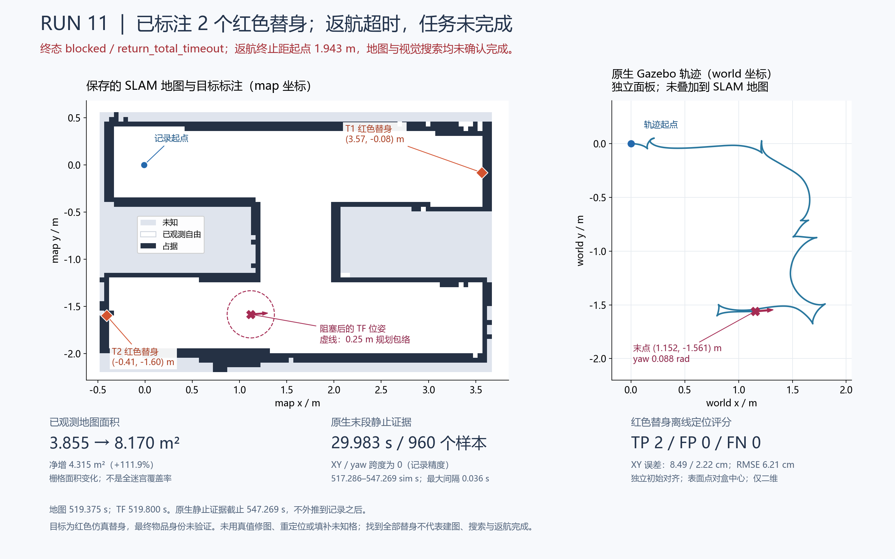

# 第二轮自主探索与返航试验

2026-10-28，代码 `8a8e7ed`，WSL Ubuntu 24.04 / ROS 2 Jazzy / Gazebo Harmonic，固定 `smoke_maze.world`。本轮确认了两个红色仿真替身并扩大地图；三个探索目标成功到达，三个探索目标超时取消，返航途中再次停滞并超时。**完整任务、地图完成标志、视觉覆盖与返航验收均未通过。**

## 配置与证据

使用全新模型和地图代次 `27eb9e9d-01fa-4ab2-92e7-c6c40c1e388f`。实际加载的 SLAM 边界补丁库与参数均已核验；保持 run10 的实验参数 `distance_variance_penalty=0.05`，仓库正式默认仍为 0.5。上一轮固定输入回放没有证明 0.05 更好，本轮保留它仅便于对照。

任务路径包络仍为 R=0.25 m；前沿终点预留 0.05 m 到达误差和半格对角线，Nav2 XY 容差改为 0.05 m、`stateful=false`，BT ACK 等待为 200 ms。运行节点读取的任务/返航预算为 600/180 wall 秒，单探索目标仍为 90 wall 秒。初始净空先验仅用于规划副本，原始地图保留 1 个起点盲区格，随后被实际观测补齐。

初始环视的独立原生车体记录给出最大累计转角 6.40367 rad、中心漂移 0.0654 mm。环视后的 map→odom 平移修正约 1.09 cm，yaw 修正 −0.02094 rad。未将轮里程计或 Action 成功单独当作物理运动证明。

## 导航结果

以下误差来自目标终态日志到达附近的 TF 快照，各快照保留地图和 TF 的采样时间。它们不是原子同步的控制器内部判定值。

| token | 类型 | 终态 | XY 误差 | yaw 误差绝对值 |
|---|---|---|---:|---:|
| 1 | 探索 | 成功 | 0.02598 m | 0.25234 rad |
| 2 | 探索 | 90 s 超时后取消 | 0.12048 m | 0.00250 rad |
| 3 | 探索 | 成功 | 0.04256 m | 0.16922 rad |
| 4 | 探索 | 90 s 超时后取消 | 0.41194 m | 0.00063 rad |
| 5 | 探索 | 成功 | 0.04116 m | 0.25404 rad |
| 6 | 探索 | 90 s 超时后取消 | 0.08427 m | 0.00167 rad |
| 7 | 返航 | 总预算超时后取消 | 1.94343 m | 0.11876 rad |

三个成功目标的误差都在 5 cm 内；七个终态附近的实际 R=0.25 m 圆形包络在当时原始地图上均无未知或占据冲突。取消目标不计作成功到达，不能拿其误差指控成功容差失效。本轮未复现 run10 的到达后安全连通区阻塞，但不证明所有后续地图变化均已安全。

结束探索时当前已知连通区域内 frontier 为 0，但仍有两个未解决的失败区域，所以 `map_complete=false`。检测器不发布已验证的视觉搜索覆盖，因此转入返航的原因是 `perception_unverified_incomplete`。返航最终在距离记录起点约 1.94 m 的途中停滞，结果为 `blocked / return_total_timeout`，没有把“开始返航”记为返航成功。

## 地图与目标

原始地图的已观测格（自由与占据合计）从 1,542 增至 3,268，名义 0.05 m 分辨率下从 3.855 增至 8.170 m²；自由格从 1,259 增至 2,587。地图外包框随探索扩展，以上是观测面积变化，**不是相对于真值的覆盖率**。

两个确认目标的地图坐标约为 `(3.5653, −0.0826)`、`(−0.4069, −1.5961)`，分别由 281、92 个不同采集时刻的观测累积确认。隐藏目标数量与世界位置只用于离线评分，没有输入规划器或检测器。

使用初始静止阶段 29.25 sim s 的同时间原生 world pose、map/odom→laser TF 与已记录的激光外参建立固定 map→world 对齐，并用 17 帧交叉检查。对齐未拟合目标，也没有用最终位姿去消除后续 SLAM 漂移。既定 0.20 m 平面距离阈值下，离线评分为 TP=2、FP=0、FN=0；两个 XY 误差为 0.08492、0.02222 m，RMSE=0.06207 m。比较的是 RGB-D 可见表面点与真值盒中心，未做隐藏的表面到中心校正；不评价 Z 精度。这不能替代视觉搜索覆盖、正式物品识别或完整任务验收。

## 停止与待解决问题

独立原生轨迹共 11,976 样本，车体离初始位置最远约 2.3793 m。任务终态之后末 29.983 sim 秒有 960 个新鲜样本，最大间隔 0.036 秒，x/y/yaw 跨度在记录精度内均为 0。任务退出审计另有 30 个新鲜静止里程计样本，目标终态已确认、无待接受目标、无清理错误。全部本轮已记录的 ROS/Gazebo 进程已核实退出。

探索目标 2/4/6 的朝向很接近要求，但位置仍有侧向残差。MPPI 当前在距离目标 0.5 m 内启用最终朝向代价；差速车纠正侧向误差需要先偏转，这与提前摆正后停滞的假说一致。[Nav2 1.3.13 GoalAngleCritic 源码](https://github.com/ros-navigation/navigation2/blob/1.3.13/nav2_mppi_controller/src/critics/goal_angle_critic.cpp#L37) 支持该代价启用条件，但没有预测轨迹和各项代价分解，尚不能确认唯一根因。下一单变量实验拟把该阈值改为 0.05 m，其他控制参数保持不变；需检查容差边缘切换和旋转后的漂移。

返航停点离 home 仍很远，不能直接套用上述近终点解释。下一轮增加全局路径、连续 TF/里程计，以及控制器→平滑器→碰撞监视器三段速度记录，区分规划路径、局部优化和输出限速。当前未通过部分不因目标评分良好而改为通过。

本地原始证据位于 `outputs/ros_smoke/`，包括 `run11-provenance.json`、`run11-mission-observer.json`、其逐目标 snapshots、`run11-final-map.{yaml,pgm}`、`run11-final-annotated.svg`、`run11-independent-alignment.json`、`run11-target-evaluation{,.provenance}.json` 及 `mission_run11/`。outputs 不随源码自动上传；复现实验应同时保存这些记录、日志、对应 commit 与参数文件。
