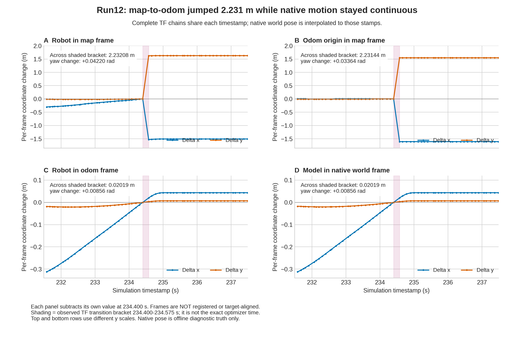

# 第三轮自主流程：末端旋转与定位跳变

2026-10-28，运行代码 `3d80629`，新模型与地图代次 `35a9dbde-30b3-46a7-b2ae-35bcdec21a66`。本轮在第 3 个探索目标途中出现 SLAM 坐标跳变，任务保护取消导航，将历史坐标标为无效并停止。**未进入返航，完整任务未通过。**

## 对照设置

沿用 run11 的物理模型、地图边界补丁、R=0.25 m 规划包络、终点到达余量、Nav2 XY=0.05 m 与 `stateful=false`。控制参数只将实验用 `FollowPath.GoalAngleCritic.threshold_to_consider` 从 0.5 改为 0.05 m；运行中的参数服务确认该值，enabled=true、weight=3。仓库正式默认未因此修改。

SLAM 继续使用实验 `distance_variance_penalty=0.05`，正式默认仍为 0.5；扫描匹配与回环均开启。任务/返航/单目标预算为 600/180/90 **墙时秒**。仿真实时率约 0.5，90 wall 秒并不等于 90 sim 秒。

初始环视实际转角约 6.39792 rad、中心漂移约 0.0654 mm；之后 map→odom 平移约 1.06 cm、yaw −0.01745 rad。原始起点仍有 2 个未知格，只在显式净空保证的规划副本中填充，未修改 SLAM 地图。

## 目标 2：旋转尚未完成时预算到期

目标 1 成功，终态日志附近 XY 误差约 0.00605 m、yaw 误差约 0.25112 rad。其初始位姿与 run11 不同，不能把单次成功当作只改 GoalAngle 阈值的因果证明。

目标 2 持续 90.806 wall 秒，模拟时间仅推进 46.471 秒。首次进入 5 cm 位置容差在发送后 79.087 wall 秒，此时朝向误差仍为 1.70687 rad；剩余约 11.719 wall / 5.971 sim 秒用于转向。取消附近的位置误差为 0.02151 m，朝向误差为 0.33636 rad，尚未满足 0.26 rad 的要求。

取消前控制器、平滑器和最终输出仍有约 −0.164 rad/s 的转向，里程计也记录相应旋转，朝向误差在下降；没有末端零角速度卡死的证据。前段距目标约 1.23 m 时曾缓慢运动，消耗了大量预算。缺少预测轨迹、各项代价和同期局部代价地图，尚不能将慢行归因于某一 MPPI 项，也不能保证单纯延长时间必然成功。

保存的 89 条目标 2 全局路径末点均与请求目标一致，没有发现 tolerance fallback 改写终点。870 组接收年龄在 0.3 wall 秒内的三段速度中，未观察到“平滑命令非零而最终命令归零”；这些是异步采样，不能排除采样间的短暂抑制。

## 目标 3：SLAM 修正发生不连续变化

在 TF 源时间 234.400–234.575 sim 秒的观测过渡区间内：

| 同时间链路或独立位姿 | XY 变化模长 | yaw 变化 |
|---|---:|---:|
| map→odom | 2.231438 m | +0.033642 rad |
| odom→base_link | 0.020193 m | +0.008561 rad |
| 原生 world 车体位姿，插值到同时间 | 0.020192 m | +0.008559 rad |

1,739 条完整 TF 链的组合残差最大约 7.02e−16 m。过渡前后约 3 秒内的原生记录连续，最大样本间隔 36 ms、最大相邻步长约 4.15 mm。证据支持 SLAM 的 map→odom 突变，不支持真实车体瞬移、里程计跳变或把不同时间的 latest topic 混配的解释。

SLAM 关联扫描的时间是 234.375 秒，其实现把 TF 时间戳设为扫描时间加 `transform_timeout=0.2 s`。因此上表是 TF 观测区间，不能把 234.575 秒当作精确优化完成时刻。同期 Ceres 日志提示请求 50 线程超过编译上限 20；源码中该请求是硬编码，警告本身不证明优化失败或线程数是根因。

停止前已成功序列化位姿图。只读解析得到 135 个节点、143 条边，最后一条新增远距离约束连接旧节点 9 与新节点 134，约束位置与该帧里程计位置相距两米多。这是可疑关联证据；归档的边不带“回环”类型字段，不能仅凭非相邻 ID 就断言是哪条建边路径触发。正在用保存的扫描和回环监听器进行同输入对照。

任务结果为 `blocked / localization_jump_requires_reanchor`，`coordinates_valid=false`，地图、视觉覆盖、返航与任务成功标志均为 false。此前保存了两个红色替身的历史观测，但它们与 home 的旧 map 坐标不能继续作为当前地图上的有效标注；本轮没有给这些目标计算通过分数，也没有输出有效目标标注图。

## 证据与停止

冻结观察器 `outputs/setup/observe_run12.py` 记录 1,741 个 TF 样本（1,739 个完整同时间链）、3,403 组速度采样、180 条全局路径和 5,877 个原生车体样本，错误列表为空。三个目标终态日志均被保存。通用版本已整理为[仿真任务观察器](mission-observer.md)，不发送运动或导航请求。

终态后的末 29.999 sim 秒包含 958 个新鲜原生样本，最大间隔 36 ms，x/y/yaw 跨度在记录精度内均为 0。任务退出审计另有 30 个静止里程计样本，目标终态与停车已确认，无待接受目标或清理错误。本轮所有已记录 ROS/Gazebo 进程已核实退出。

本地 `outputs/ros_smoke/` 保留 `run12-mission-observer.json`、逐目标 snapshots、`run12-goal2-diagnostic.{json,md}`、`run12-localization-jump-analysis.json`、`run12-after-jump-graph.{posegraph,data}`、`run12-after-jump-map.{yaml,pgm}`、`run12-graph-audit/`、对应分析脚本、运行参数与日志及 `mission_run12/`。原始数据不自动上传，复现时需同时保留其 hash 和代码版本。
