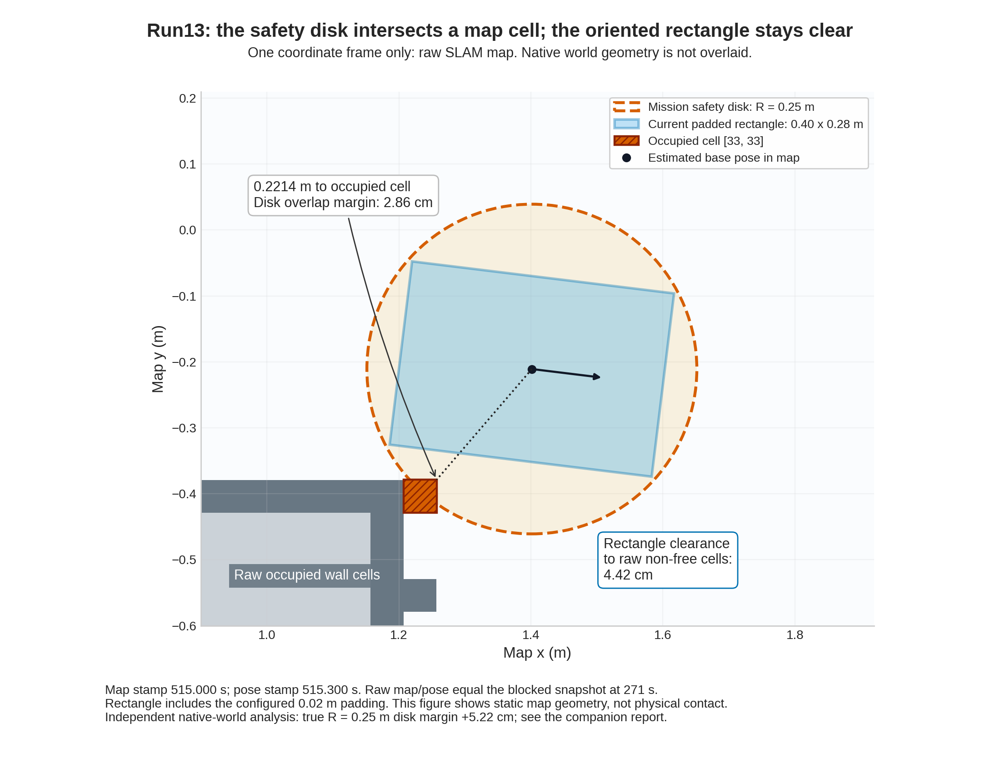

# run13：近目标停滞与地图净空保护

2026-10-28，运行代码 `a807301`，地图代次 `fcec1726-db49-4c43-a920-6a72e12f386f`。两个探索目标成功，第三个超时，随后因当前位置不满足任务的圆形安全包络而停止。确认了一个红色仿真替身，未完成建图、视觉覆盖或返航，`mission_success=false`。

## 设置与数据

采用 run12 固定输入回放验证过的实验候选：保持回环开启，将 SLAM 粗回环搜索窗从 8 改为 1 m。仍使用实验 `distance_variance_penalty=.05` 和 MPPI `GoalAngleCritic.threshold_to_consider=.05`，正式默认分别为 .5 和 .5。任务/返航/单目标上限为 900/240/120 **墙时秒**。本轮同时开启 MPPI 预测路径发布；只有路径订阅，没有候选轨迹 Marker 订阅。

初始环视的原生实际转角为 6.40146 rad、中心漂移约 .0654 mm。固定 map→world 对齐来自旋转前 81.875–83.875 sim 秒的 17 帧，与目标或最终位姿无关。独立对齐没有在任务结束后重新拟合。

本轮录下激光、TF、里程计、地图、全局路径、控制器变换后路径与最优预测路径、三段速度以及任务事件。录包正常 SIGINT 关闭，全部 715,557 条存储消息可读，逐话题计数与 metadata 一致，解析前后哈希未变。**录制端报告 83 条传输层丢失，不能把存储记录完整读出等同采集无损。** 最优路径每条含 56 点，子 pose 时间戳均为 0；不能把这些点当作各自有实测时刻的车体轨迹。

观察器保存了原始 global/local 代价地图。首次 mission 参数服务回复未被捕获，观察器如实返回非零并保留错误；随后成功取得的独立 `ros2 param dump` 是另一份证据，没有改写观察器 JSON。后续观察器修复增加有界只读重试，历史结果保持原样。

## 第三个目标的停滞

目标 3 为 `(1.432117, -.003728, -1.951303)`，单位 m、rad。执行约 120.040 wall / 59.530 sim 秒后取消。前 30 wall 秒，目标距离从约 .457 m 降至 .210 m；后续约 90 wall 秒仍在 .209–.210 m 附近，控制器自身的平移输出接近零。这不是已经进入 XY 容差后仅等待完成末端转向的情形。

保存的 106 条全局路径末点均与请求相同，没有发现 NavFn 改写终点。某些路径在起点附近出现短距离往返，该几何也进入了控制器的变换后路径。尚不能据此断言往返几何独自导致停滞：在实际配置和这一距离范围内，若干路径引导代价项已经进入近目标禁用区。需要保留控制器选择的预测轨迹和距离门槛一起分析，而不是只看 RViz 路径或推测某一代价项。

进一步从录包获得 118 条全局路径、1,168 对控制器路径。全局末点均精确匹配目标；变换后末点按最近已记录 TF 还原的最大偏差约 3.88 mm。停滞段 862 组最优预测的展开距离中位数仅 3.99 mm，yaw 跨度中位数 .0118 rad；目标方向约在车体左侧 90°，未形成明显的先转向再接近行为。早期代表局部地图中部分原地旋转姿态有占用冲突，后期代表快照则无；不能将全段解释为始终无法旋转。

该版本的 [PathAlign](https://github.com/ros-navigation/navigation2/blob/1.3.13/nav2_mppi_controller/src/critics/path_align_critic.cpp)、[PathAngle](https://github.com/ros-navigation/navigation2/blob/1.3.13/nav2_mppi_controller/src/critics/path_angle_critic.cpp) 和 [PathFollow](https://github.com/ros-navigation/navigation2/blob/1.3.13/nav2_mppi_controller/src/critics/path_follow_critic.cpp) 在距真实 goal 小于配置阈值时跳过。本轮对应 .5/.5/1.4 m，目标 3 距离全程小于 .458 m；[GoalAngle](https://github.com/ros-navigation/navigation2/blob/1.3.13/nav2_mppi_controller/src/critics/goal_angle_critic.cpp) 仅在 .05 m 内启用。这说明这一段缺少上述方向代价项的引导，但仍有位置目标、障碍代价与采样优化影响，没有逐项代价记录，不能宣称唯一根因。

## 为何矩形车身可通过，任务仍拒绝当前位置

终态 map 位姿约 `(1.401459, -.210812, -.121633)`。原始地图中只有占据格 `[33,33]` 侵入该位姿的 R=.25 m 圆盘，圆心到这个格子的矩形边界为 **.221428 m**，少了约 2.86 cm。按当前所在格中心进行任务检查，则有两个占据格冲突。没有把未知格改成自由格。

同一位姿和朝向下，Nav2 当前使用的加 padding 矩形半长/半宽为 `.20/.14 m`，与原始非自由区仍有约 **4.42 cm** 间隙。矩形足迹检查与任务的圆形安全包络要求不同，因此两种检查结果可以同时成立。

固定初始坐标对齐下，原生停点约 `(1.406782, -.179565, -.098955)`；map/native 位置差 **3.17 cm**、航向差 **−1.30°**。原生中心到最近真实静态墙体为 **.302242 m**，对 R=.25 仍余约 5.22 cm；配置的加 padding 矩形到真实静态盒子的二维间隙约 9.98 cm。这支持地图净空保护触发，不能把本次停止等同于真实碰撞，也不替代完整 CAD 接触审计。

定位偏差、墙面地图偏差和格子覆盖规则共同缩小了估计净空。整个观察区间 map/native 位置差最大约 3.50 cm，相邻 map→odom 最大平移更新约 1.07 cm，没有重现 run12 的米级跳变。`coordinates_valid=true` 仅表示未触发坐标作废保护，不代表误差为零，也不验证正确回环的接受能力。

## 保存、停止与后续对照

任务结果为 `blocked / robot_footprint_not_in_known_safe_component`，单目标超时留下一个未解决前沿。地图、视觉覆盖、返航验证与任务成功均为 false，正式目标定义仍未确认。

原始地图和位姿图已保存，SLAM 序列化返回 result=0。末段 29.992 sim 秒包含 962 个新鲜原生样本，最大间隔 35 ms，x/y/yaw 跨度在记录精度内为 0。任务 SIGINT 清理另取得 29 个静止里程计样本，目标终态和停车审计通过；本轮所有已记录进程均核实退出。

停点诊断在 blocked 之后采集。两份 raw 地图内容/几何和 map 位姿一致，原生轨迹在对应区间也静止，因此可作静态对照；晚取的代价地图不能称作超时瞬间控制器的原子输入。下一步对照 Nav2 RPP 的路径跟踪与显式转向行为，并单独核对任务圆形净空和 Nav2 足迹的契合；保留本轮失败，不以修改占据格或缩小任务安全半径消除报警。

本地 `outputs/ros_smoke/` 保留 `mission_run13/`、`run13-mission-observer.json` 及快照、`run13-inputs-bag/`、`run13-bag-analysis/`、`run13-independent-alignment.json`、`run13-footprint-localization-analysis.{json,md}`、`run13-blocked-*`、`run13-final-map.{yaml,pgm}`、`run13-final-graph.{posegraph,data}`、实际参数与运行日志。运行观察器冻结于 `outputs/setup/observe_run13.py`，SHA256 为 `6a6c9e65bc4ffc0ebc496bf607a58aed7a0ee11e19907882ce2a1b74d8d8278e`。原始大文件未上传；可复核来源哈希保存在各分析 JSON 中。
