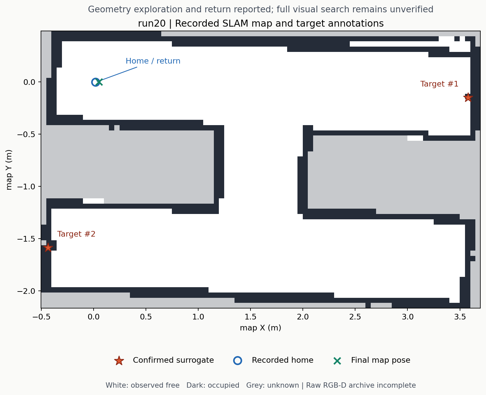

# run20：更严格到位阈值下的探索、标注与返航

2026-10-31，代码 `b80aa8de6799520b16fb7f70dcb1ac43d21d5f2a`，epoch `76f2f4d2-461c-469f-b8b4-40405854f92d`。Gazebo 运行完成并关闭，累计 645.38 wall 秒，全部自有进程组清空。当前只能确认这一小迷宫中的几何探索、红色替身标注和返航；完整视觉搜索与实车实验尚未验收。

| 项目 | 记录及范围 |
|---|---|
| 生成与启动 | 单次创建请求；early、before-motion、terminal 三快照均为单一 LIMO ID 114；初始环视通过 |
| 导航 | 5 个 frontier 与 1 个 home 目标均报告成功 |
| 到位参数 | Nav2 XY 由 .05 收紧至 .03 m；mission 的 .05 m 判据保持。该 Nav2 参数也影响 RPP 末端转向切换 |
| 在线停车观察 | 5 个窗口各接受 3 帧；窗口结束时 XY 偏差 20.28–28.98 mm |
| 独立图像审计 | **0/5 末帧具备完整 RGB-D 原始记录**：4 段缺 depth、1 段缺 RGB；5 组采样时刻 TF 均重建一致 |
| 地图 | 最终 frontier=0、unobserved=0，`map_complete=true`；未独立证明全迷宫地图精度 |
| 标注 | 2 个 confirmed 红色替身；独立起点锚点下平面残差约 22.68 / 4.17 mm，仅描述性，含表面点与盒子中心差别 |
| 返航 | map 内 XY 31.49 mm；相对环视后原生起点 XY 37.93 mm、yaw 7.52°；home 阈值为 .15 m / .26 rad |
| 停止 | 终态后 967 个 native 样本跨 29.993 sim 秒，采样 XY/yaw 变化为零 |
| 完整成功 | `visual_coverage_complete=false`、`target_definition_verified=false`、`mission_success=false` |

本轮路线与 run15 不同，因此不能把一次成功返航当成所有到位问题已解决。相机有效范围、有限多朝向观察、跨迷宫重复性与正式目标识别仍需验证。world 的目标位置、数量和原生运动仅用于运行结束后的离线评分，不参与控制。

录包为 1 个 MCAP、335008 条存储记录，日志累计 transport lost=2355。扫描到存储末端不等于采集无损。五个末帧的缺图失败原样保留，没有更换抽样时间点；在线 ledger 的 15 帧计数也不等于全部图像已独立复核。下一轮应先完善 RGB-D 留证。

原始 `perception` 进程在关闭时退出 1：SIGINT 已停止 rclpy context，随后重复 shutdown 抛错。其他自有进程组与该组均已清空，没有 TERM/KILL 升级；不能据此声称所有组件退出码均为零。该问题的后续源码修复不追改本轮日志。

原始报告、地图、缺图审计及精确 runner 副本见 [run20 存档](../experiments/run20/README.md)。地图图像是离线结果；实时查看请按 [Gazebo / RViz 说明](visualization.md)启动。只打开查看客户端不会重启已结束的实验。
