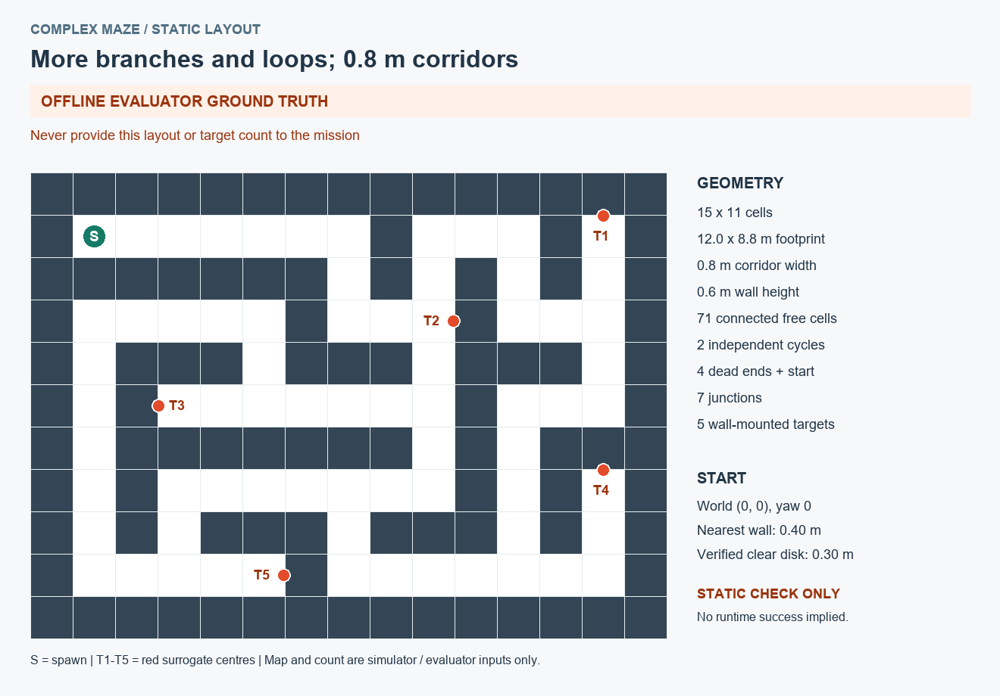

# 更复杂的迷宫：建图与目标标注测试

`worlds/complex_maze.world` 是新增的中等规模场景。相比原来的两条短走廊，它增加岔路、死胡同和回路，继续使用差速 LIMO、红色 RGB-D 替身和默认不返航的任务。

| 项目 | 新场景 |
|---|---|
| 栅格布局 / 总占地 | 15 × 11 格 / 12.0 × 8.8 米（含墙） |
| 通道宽度 / 墙高 | 0.8 米 / 0.6 米 |
| 拓扑 | 2 个独立回路、7 个三岔点；5 个死端中一个为起点，另有 4 个死胡同 |
| 仿真替身 | 5 个贴墙红色物品，分布在不同支路；数量和位置不给任务节点 |
| 出生点 | 世界坐标 `(0, 0)`，朝向 `0`；静态几何验证支持 0.30 米起点净空声明 |



上图、ASCII 布局和 `.metadata.json` 是场景布置与离线评价真值。机器人仍只使用扫描、图像、里程计和 SLAM 生成的地图探索，不预加载这些真值。几何通行验证不等于实际导航或识别已通过。

## 准备本次运行

先结束旧任务：在任务终端按 `Ctrl+C`，等取消和停车检查完成，再关闭旧感知、导航、Gazebo 和 RViz。新场景必须重新启动 SLAM 和任务，使地图及 map epoch 属于新会话。

打开五个终端，每个执行 `wsl -d Ubuntu-24.04` 进入 Ubuntu。如果提示符有 `(base)`，分别执行 `conda deactivate`。以下均为 Ubuntu Bash 命令，五个终端都先执行：

```bash
cd /mnt/c/Users/Admin/.codex/worktrees/0dd9/Personal_Plan/LIMO_Map_Nav_FromSimToRel
source /opt/ros/jazzy/setup.bash
source /mnt/f/study/Personal_Plan/LIMO_Map_Nav_FromSimToRel/install/local_setup.bash
source outputs/slam-steady-map-ws/install/local_setup.bash
source install/local_setup.bash
export ROS_DOMAIN_ID=73
export ROS_AUTOMATIC_DISCOVERY_RANGE=LOCALHOST
export GZ_PARTITION=limo_maze_jazzy
export LIMO_TRIAL="$PWD/outputs/ros_smoke/complex_maze_20261110_01"
```

每轮使用新名称，并在五个终端保持一致。配置从 `config/complex_maze.yaml` 直接加载；地图文件也直接用仓库路径，无需重新安装场景资源。

本次另增加了感知节点的 `retention_max_requests` 参数，默认值仍为 128。开发者本机完成构建后可直接运行；其他机器或以后从 Git 更新源码后需先构建再加载安装：

```bash
colcon build --base-paths src --packages-select limo_maze_perception
source install/local_setup.bash
```

## 五终端启动顺序

**终端 1：新迷宫和 Gazebo 窗口。**

```bash
mkdir "$LIMO_TRIAL" &&
ros2 launch limo_sim_bringup sim.launch.py \
  world:="$PWD/worlds/complex_maze.world" \
  headless:=false \
  spawn_artifacts:="$LIMO_TRIAL/spawn"
```

`mkdir` 报目录已存在时换新的运行名称，不删除旧结果。出生点参数使用默认值；改变场景或出生点后需要重新验证起点净空及配置中的场景指纹。

**终端 2：建图与导航。**

```bash
ros2 launch limo_maze_bringup mapping_navigation.launch.py \
  nav_params:="$PWD/src/limo_maze_bringup/config/nav2_rpp_tf_experimental.yaml" \
  slam_params:="$PWD/src/limo_maze_bringup/config/slam_smoke_experimental.yaml"
```

首轮沿用小迷宫的 SLAM/Nav2 参数作为对照起点，保持车体膨胀、安全余量和 TF 容差。SLAM 文件名中的 `smoke` 指参数来源，不会加载旧地图；这些参数在新迷宫的闭环表现仍待实测，尚不能称为已完成大场景调参。

**终端 3：传感器、导航就绪检查和初始环视。**

```bash
/usr/bin/python3 scripts/check_sim_runtime.py \
  --timeout 120 --output "$LIMO_TRIAL/sim-runtime.json" &&
/usr/bin/python3 scripts/check_navigation_runtime.py \
  --output "$LIMO_TRIAL/navigation-runtime.json" &&
/usr/bin/python3 scripts/initial_survey.py \
  --execute --verified-clear-radius .30 \
  --output "$LIMO_TRIAL/initial-survey.json"
```

最后须显示 `success: true` 和 `stop_verified: true` 才继续。失败则保留该报告，停止后续自主任务步骤。环视声明只适用于本场景原始布局与默认出生点，不适用于任意实车或修改后的场景。

**终端 4：识别与留存。**

```bash
ros2 run limo_maze_perception red_rgbd_detector --ros-args \
  --params-file "$PWD/config/complex_maze.yaml" \
  -p retention_output_dir:="$LIMO_TRIAL/retained"
```

**终端 5：RViz。**

```bash
bash scripts/view_sim.sh rviz \
  --runtime /mnt/f/study/Personal_Plan/LIMO_Map_Nav_FromSimToRel
```

**回到终端 3：启动自主任务。**

```bash
ros2 run limo_maze_mission mission --ros-args \
  --params-file "$PWD/config/complex_maze.yaml" \
  -p output_dir:="$LIMO_TRIAL/mission"
```

不要同时运行旧任务节点或在 RViz 中发送其他导航目标。目标识别不会提前结束探索；默认完成后停在当前位置，不做拿取、搬运或解救。

## 本场景的运行预算与结果

配置将总任务墙钟上限设为 **3600 秒**，单导航目标为 **180 秒**；建图后最多选择 **6 个观察站、每站 4 个朝向，共 24 个动作**，观察阶段上限 **720 秒**，同时受任务总时限限制。这些是上限，不是预计耗时或全场视觉覆盖证明。所有时限仍有限，不屏蔽地图、TF、导航和停车失败。

较多探索点也会产生停车观察，因此把任务端接受样本上限、感知端请求和存储工作上限一起设为 256，窗口上限为 128。任务元数据上限增至 16 MiB，避免默认 2 MiB 先耗尽；原始帧文件预算为 768 MiB，不等于一开始分配或持续录像。预算仍可能在反复失败/重试时耗尽，结果会如实报告。

结果保存在 `$LIMO_TRIAL/mission`：查看任务 JSON 的 `map_complete`、`mapping_annotation_complete`、`task_success` 和 `reason`；同名 `_map` 目录内 `annotated.svg` 可直接查看地图与目标编号，`targets.json` 提供坐标。仍不以历史 `mission_success` 或 `status=done` 单独判断当前任务成功。

重点观察回路是否能正确闭合、死胡同是否被探索、同一目标是否重复标号。结束后才用场景真值比较漏检、误检和定位误差；不能把 Gazebo 世界坐标直接当成 SLAM 的 `map` 坐标，误差评价需要坐标对齐。

关闭顺序为任务终端 3（等取消/停车完成）→ 感知 4 → 导航 2 → 仿真 1 → RViz 5。下一轮使用新目录和完整的新建图会话。

## 验证范围

本场景先做静态拓扑、SDF 几何和配置预算检查；尚未据此宣称完整 Gazebo 自主任务成功。实际验证结果更新到[验证记录](validation.md)。
