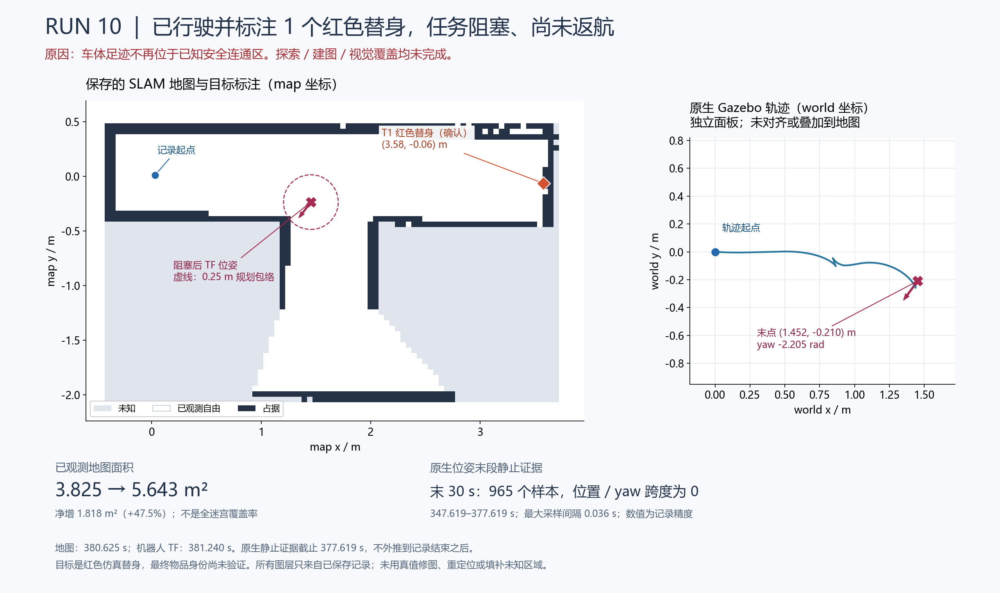

# 首次自主平移实验：run10

2026-10-28，WSL Ubuntu 24.04 / ROS2 Jazzy / Harmonic，smoke 迷宫，独立地图代次 `78bdd4cf-dc3e-4c9f-9dcb-3de420d91a25`。本轮完成了真实平移、在线扩图、RGB-D 跨帧目标确认和地图标注，但未完成全场搜索或返航。

使用固定 LIMO 接触补丁、SLAM 2.8.5 边界补丁及 smear=.01。实验另将 distance_variance_penalty 从 .5 改为 .05，未改变仓库正式默认值。原始 scan/TF 和接受位姿均已保存。同输入的两次真实 SLAM 回放接纳时间戳完全相同：159 帧输入、45 帧接纳，最终平移修正分别约 2.071 cm / 2.099 cm，未显示明显改善。因此不能把 run10 较 run9 的改善归因于距离参数。

## 执行结果

| 证据 | 结果 |
|---|---|
| 初始观察 | 真车体最大累计旋转约 6.4 rad；map→odom 最终 xy=(.02935,.00827) m、yaw=−.02094 rad。 |
| 实际自主位移 | Gazebo 原生 model pose 最大离起点距离 **1.46670 m**；最后停在 world (1.45160,−.20970) m，yaw=−2.20460 rad。不是仅凭 Action/轮里程计推定运动。 |
| 原始地图增长 | 已观测格 1530→2257，约 **3.825→5.6425 m²**；包含 free 和 occupied，不包括先验填充。不能据此宣称整图覆盖率。 |
| 目标确认 | 红色视觉替身 1 个，231 个不同采样时刻的命中；map 坐标约 (3.5804,−.0648) m。未宣称找齐所有物品或完成正式类别识别。 |
| 后段速度 | 28.37 秒观察窗口中最大命令约 0.0996 m/s、0.3025 rad/s；不是全程速度上限证明。 |
| 停车 | 原生世界位姿最后 30 个模拟秒、965 个样本，最大采样间隔 .036 s，x/y/yaw 跨度在记录精度下均为 0。仅证明该记录窗口内静止。 |
| 退出 | SIGINT 后独立审计确认无待接受目标、已有终态、20 个新鲜静止 odom 样本；任务 JSON 保持 blocked，没有改写为成功。 |

任务自动发送 4 个导航目标：第 1 个在周期重规划时出现 ComputePath ACK 超时并中止；第 2 个成功；第 3 个在 90 秒任务目标预算到期后被取消，收到 CANCELED 终态；第 4 个成功。随后任务检查发现当前位置不在 R=.25 m 的安全连通区，进入 `blocked`，没有继续发目标或返航。几何完成、视觉覆盖、返航、总任务成功均为 false。

## 停止原因与修复方向

该次停止由 **occupied 格与 R=.25 m 圆包络相交** 引起，不是未知格。实际位姿到最近占用格矩形约 .22697 m；将位姿离散到格中心后为 .21506 m，因此格中心近似加重问题，但不是唯一原因。

名义第 4 个目标仍满足 R=.25，剩余净距只有约 .01149 m；实际停点距目标约 .04145 m，落在 Nav2 的 .15 m XY 成功容差内，却已超出目标所剩安全裕量。此时 padded 矩形在 raw map 中全为自由，局部/全局 costmap 无 lethal 或 unknown 格，但有 inscribed 膨胀代价；这不能被表述为已发生物理碰撞。

应让候选终点的安全裕量包含 Nav2 到达容差与格中心量化误差，并保持通路 R=.25 不变。初步冻结快照验证支持 XY 容差 .05 m、终点额外裕量 `.05 + sqrt(2)*resolution/2`，仍能选择有效前沿；此时不自动从已 blocked 的位置恢复任务。另一个独立问题是 BT 的动作 ACK 默认仅 20 ms，下一轮仿真配置将单独增加调度容忍并观察是否消除该超时。

## 证据位置

本地 `outputs/ros_smoke/` 保留 `motion_mission_run10.json`、`run10-mission-observation.json`、`run10-blocked-snapshot.json`、`run10-blocked-costmap-{snapshot,summary}.json`、`run10-blocked-map.{yaml,pgm}` 和 `run10-blocked-annotated.svg`。任务结果与独立退出审计位于 `mission_run10/`。大型原始输出不提交 Git；本页的小型总结图作为实验记录入库，实现与配置由提交记录追踪。

地图与目标图层均为当前 map 坐标。世界轨迹没有未经标定就叠加到地图；地图初始坐标约定不能证明闭环优化后的全局对齐。实车传感器、目标定义、历史起点/标注随位姿图优化保持一致，以及控制器失联租约仍待验证。
