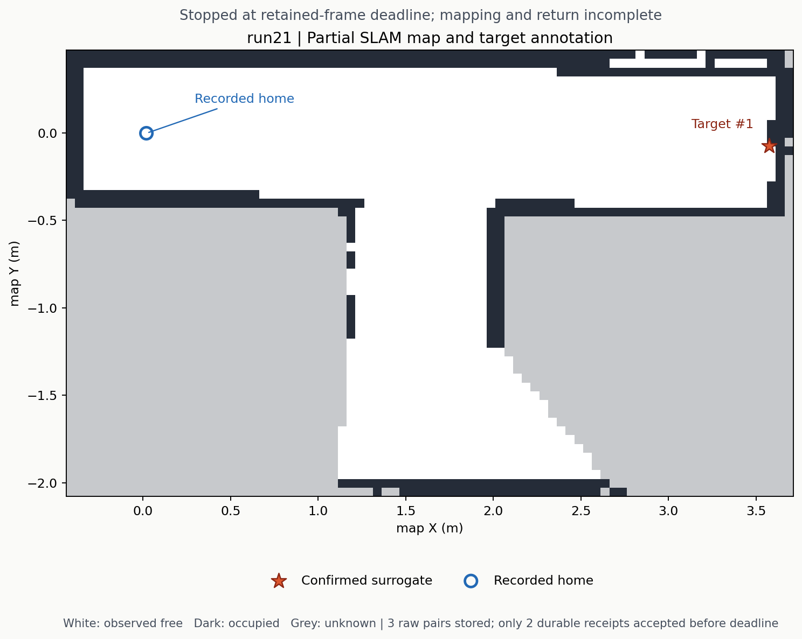

# run21：真实仿真暴露留存回执超时

2026-10-31，代码 `2d36634caf0665e6b0af88e7452575ae69c0d0dd`。本轮把精确 RGB-D 留存接入实际 Gazebo 自主任务，并开启建图后的有限多朝向观察；在第一个取得成功导航终态的 frontier 观察窗中，第三帧的持久化回执未及时获 mission 确认，任务按既有规则停止。**建图、地图完成后的观察和返航均未完成。**

| 项目 | 原始结果 |
|---|---|
| 导航 | 两次 frontier 下发：第一次失败终态，第二次成功终态；无 home 下发 |
| 处理窗口 | 接受三个样本，RGB/depth 戳为 140.9、141.0、141.2 sim 秒，跨度 0.3 秒；处理条件曾 satisfied |
| 留存确认 | mission 保存时为 stored / stored / pending；窗口 `retention_window_deadline` |
| 最终原始文件 | producer 最终三帧均 stored；三组固定 request、原图、标定与 manifest 均保留 |
| 严格离线审计 | `passed=false`，因 consumer 已 faulted 在前置检查停止；不能追认窗口成功 |
| 标注 | 一个 confirmed 红色替身，map 坐标约 (3.575, -0.073) m；未做真值误差或正式类别验收 |
| 终态 | `blocked` / `frame_retention_failed`；map complete、visual coverage、returned pose 和 mission success 全部 false |
| 失败停点 | 同一 native 模型相对 home 静止括点位移 1.1585 m，yaw 变化 -1.1777 rad；这是停点位移，**不是成功返航误差** |
| 静止尾窗 | 965 个 native 样本跨 29.982 sim 秒，采样 XY/yaw 变化为零，最大间隔 0.036 秒 |

本轮维持 Nav2 到位 XY 0.03 m、mission 观察 XY 0.05 m、yaw 0.26 rad、停车判据 0.5 秒、观察窗口 12 秒；writer / request / shutdown 时限仍为 5 / 10 / 8 秒。留存容量设置为 96 帧 / 256 MiB，消费者 96 帧 / 4 MiB；本次失败不是容量用尽。预设最多三个观察站、每站四朝向、12 次下发、360 秒，因建图提前停止而未进入该阶段。

第一份留存请求到窗口截止剩余约 10.0469 wall 秒。producer 三个文件写入任务分别在请求后约 2.019、4.307、8.599 秒结束；文件任务结束与最终 checkpoint 持久化、回执传输和消费者确认是不同环节。第三个文件写入结束不能替代 mission 截止前尚缺的确认。现有记录不足以把全部耗时归因于某一种启动、磁盘或调度因素。

为定位开销，运行关闭后对相同三对 640×480 RGB8/32FC1 图像和请求做了一次 baseline、一次候选回放。baseline 第三个请求超时；候选仅改变 helper 的 Python 启动方式为 `-S -B` 并限制共享包搜索路径，单次回放在 9.204 秒取得全部持久化回执，相对原窗口剩余时间仅余约 0.843 秒。两次回放均清理了自有 helper。文件、请求与 manifest 的回放核对不改变真实任务的失败结果。

这组比较没有并发 Gazebo/图像处理负载，也没有重复或随机化顺序；磁盘缓存与主机调度未受控，不能声称稳定提速或已解决真实任务超时。候选第二个 worker 仍耗时约 4.091 秒。随后将该最小启动改动加入生产源码，writer、进程归属竞争和原 lifecycle 的定向回归 **34/34 通过**，测试期间相关源码哈希未变，原始日志收录在归档 `writer-benchmark/production-focused-01.*`。截至本报告，修改后的真实 Gazebo 任务尚未验证；下一轮应保持原时限和停车/到位条件，检验实际负载下的回执交付。

编排器耗时 493.421 wall 秒、退出 1。自有进程组关闭检查与 producer writer 退出均已确认；全局 token 扫描另因两个 `/proc` 权限错误未能完成，原始 `all_run_token_processes_absent=false` 未改。后续 systemd 用户会话旁证是不同 PID，不能倒推原来不可读进程已经确认无关。

完整[失败证据归档](../experiments/run21/README.md)包含三对原始图像、逐帧身份、任务结果、checkpoint、关闭证据、压缩 observer、精确 runner、回放元数据与 SHA256。其中 `retention-audit.json` 的 0/0 是审计前置拒绝后未检查帧的计数；实际接受数始终为三。归档哈希验证仅证明副本与记录一致，不撤销这次失败，也不代表完整视觉搜索或实车项目完成。
