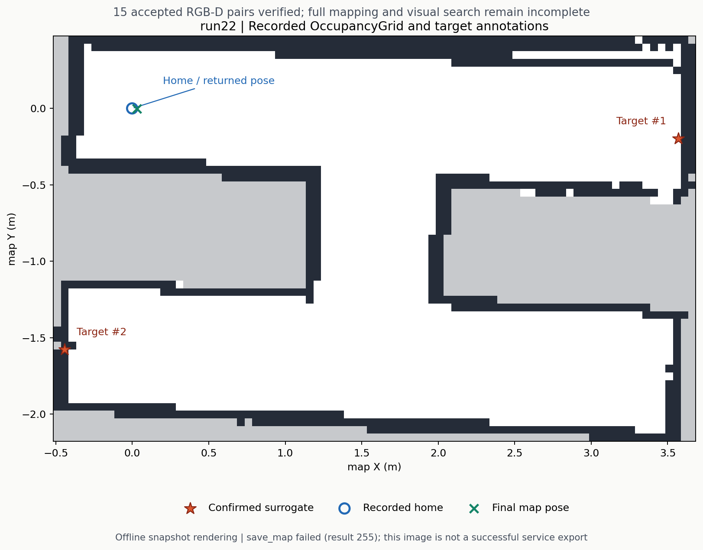

# run22：真实仿真完成全部接受图像的留存验证

2026-10-31，代码 `f6831d8c980ed1040510bf7a4d12703c07ace460`。使用隔离 Python 启动环境的 writer，实际 Gazebo 任务中五个完成的停车观察窗各接受三帧，**15 对 RGB-D 全部取得持久化回执，并在关闭后通过严格文件审计**。车辆完成返航验证；残留前沿、地图服务导出和终态静止尾窗仍未通过，完整任务不算成功。

图中白色为记录的空闲栅格、深色为占用、灰色为未知。图像直接由捕获的 OccupancyGrid 离线绘制；本轮 `save_map` 服务失败，这张图不代表成功导出 PGM/YAML。

| 项目 | 实际结果 |
|---|---|
| 导航 | 五个 frontier、一个 home 均报告成功终态 |
| 观察与留存 | 五个 complete 窗口各三帧，15/15 严格审计通过；三个额外 retired 窗口接受数为零 |
| 标注 | 两个 confirmed 红色替身；未计算真值精度或声称正式类别验收 |
| 建图终态 | 仍有三个 frontier 单元，`unreachable_frontiers_or_coverage`，`map_complete=false` |
| 地图后多朝向观察 | queue 未建立、attempts 为空；不能用 frontier 停车观察代替该阶段 |
| 返航 | `returned_pose_verified=true`；map 内 XY 30.396 mm、yaw 0.13448 rad |
| 独立 native 对照 | 相同模型 home 括点到最终采样 XY 22.478 mm、yaw -0.08563 rad；不假定 map/world 同坐标 |
| 地图导出 | `save_map` result=255，PGM/YAML 缺失；`serialize_map` result=0，posegraph/data 存在 |
| 终态尾窗 | 未验证；记录的滚动窗含终态前转向，静止和“全部晚于终态”均 false |
| 完整成功 | mission `done`，但 map complete、visual coverage、mission success 均 false |

到位和时限保持原值：Nav2 XY 0.03 m、mission 观察 XY 0.05 m、yaw 0.26 rad、停车判据 0.5 秒、观察窗 12 秒，以及 writer/request/shutdown 的 5/10/8 秒。本轮没有通过放宽阈值来获得留存通过。与 run21 的路径、时序和主机负载不同，不能据两次运行量化普遍提速或断言所有超时已经解决。

留存审计重新打开固定 accepted ID 对应的原始 RGB、depth、标定、producer、request/提交的 TF 和 manifest，核对 consumer 确认与最终 producer checkpoint。整个 15 对图像集合随后无损打包，再解压重新审计，仍为 15/15。该结果证明本次接受样本的原始文件和身份完整，不证明视觉搜索覆盖、目标召回率或 TF 本身的定位精度。

返航对照采用 native ID 114：home 事件 104.8 sim 秒前后 104.786/104.819 秒两个样本位姿相同，最后 native 样本为 276.436 秒。它与地图内返航判据分别计算。observer 首次接收终态为 257.632 秒，距离最后样本只有 18.804 sim 秒；约 30 秒滚动尾窗包含更早的转向，不能补写成独立终态静止通过。

运行结束后的栅格复核复现了未完成前沿：触发返航时，该簇三个前沿单元没有符合现有净空与保守视线要求的候选；返航后的地图对其中一个单元出现四个可达观察位置，但最近距离约 0.5831 m，超出当前 0.55 m 搜索范围。其他两个单元仍无可用视点，邻接未知区域连到地图边界，不能把它当小孔直接填掉或删除后宣布建图完成。下一步可验证有界扩大视点搜索范围，同时保持机器人半径、到位净空、已知空闲连通性和视线条件。

地图导出日志记录 `map_saver_cli` 约 2.005 秒后出现 `Failed to spin map subscription`，服务 result=255；当时已有有效 OccupancyGrid 快照，但具体是发现、调度还是消息交付问题，现有证据不能单独确定。编排器因导出子进程非零退出，未进入计划的独立终态尾窗采集。后续应在保留导出失败的同时完成独立尾窗，并单独验证有界的导出修复；不能将离线快照图改称原服务成功。

编排器累计 704.635 wall 秒、退出 1。自有进程组、嵌套 recorder 和 writer 退出已确认；全局 `/proc` 环境不可读的限制另行保留。完整[归档与解压审计命令](../experiments/run22/README.md)包含原始失败字段、15 对图像、构建证据、精确 runner、后续诊断与 SHA256；本轮未验证实车，也未完成未知迷宫全部建图和视觉搜索目标。
