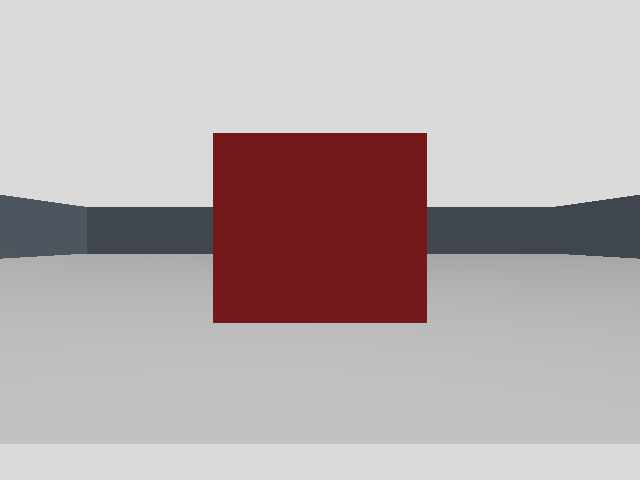
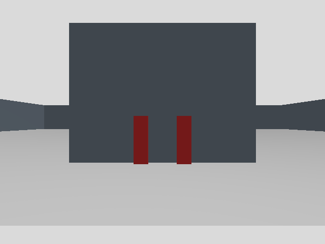

# 固定 RGB-D 窗口：12 场景闭合实验

2026-10-31，新采集入口完成 12 场景、72 组固定 RGB-D 的真实 Gazebo 渲染及离线审计。此前另做一次 0.4 m 单场景，6/6 有效，因此本目录共保存 **78 组**原始样本。旧的缺 CameraInfo 失败批次仍在[原目录](../red-calibration-20261031/README.md)，没有覆盖或补样。

运行基线为 `bd6e01c38361de468b260576c6a2a29417f71d7e`，加本次采集改动；每次采集保存实际执行源码副本和哈希。接收回调只配对并冻结消息/TF，固定窗口关闭后才检测、编码和写盘。另有原始数据检查点，在派生处理失败时仍保留既定帧位。不能由新成功断言旧 CameraInfo 缺失的唯一原因；旧记录缺少可验证的回调耗时。

## 固定输入和结果

所有场景沿用同一个预先生成的 manifest，每场新建 Gazebo 分区，domain 77，未启动导航或发送运动。采样规则是首先可用且时间戳递增的六组同步 RGB-D，拒绝/空检测也占用原槽位；没有按检测结果重试或选帧。输入未读取世界或目标真值；只有闭合后的评分器读取控制条件。

| 场景 | 六帧各自的检测数 | 六帧各自的红色 mask 像素数 |
|---|---|---:|
| 空场景 | 均为 0 | 0 |
| 正面 0.4 m | 均为 1 | 11078 |
| 正面 0.8 m | 均为 1 | 2660 |
| 正面 1.6 m | 均为 1 | 672 |
| 正面 3.2 m | 均为 1 | 192 |
| 左侧 35° | 均为 1 | 5010 |
| 右侧 35° | 均为 1 | 5010 |
| 入射角 45° | 均为 1 | 2876 |
| 入射角 75° | 均为 1 | 2136 |
| 大红色平板（薄盒实验的负样本） | 均为 1 | 40660 |
| 0.18 m 相邻双盒 | 均为 2 | 5510 |
| 部分遮挡 | 均为 1 | 1615 |

完整批次耗时 **720.513 wall s**；先行单场景耗时 **72.239 wall s**。全部输入、双方同戳 CameraInfo、图像时刻 TF、原始/派生文件和源码副本通过哈希审计。12 场景保留原计划 72 个帧位，无未运行场景或缺失帧。每场六个自有进程组均确认退出，没有使用 TERM/KILL，执行期间源码未变。

这只支持这些保存窗口的描述性计数。六个相邻帧不是六次独立场景；本实验没有认证跨光照/布局召回率、有效搜索距离或完整视觉覆盖。原生模型快照仅验证 ID/数量，`stationarity_verified=false`；没有相机真实世界位姿，故没有计算绝对位置误差。3.2 m 检出一次固定窗口，不能直接成为自主覆盖的可靠范围。

## 已确认的两个限制

大红色平板每帧也产生一个候选。当前颜色基线尚不能区分本实验指定薄盒与其他红色区域；正式课程物品未定，识别接口保持可替换。



双盒每帧保存两个检测，但当前逐项 `TargetStore.add` 在相同采集戳下只留下一个确认标注。使用保存的精确 `odom <- camera_optical_frame` TF 回放六帧，正反输入顺序都复现该问题；保留点随顺序改变。一对一关联候选在同样输入下保留两条记录、每条六次命中，正反顺序的 UID/位置相同。候选仍是隔离草稿，**没有修改在线任务包，也没有在线验证**。这证明关联行为，不证明物理目标身份或识别精度；[详细回放](association-case11.md)没有读取世界真值。



## 证据和代码

| 文件 | 内容 |
|---|---|
| `deferred-center-01.tar.gz` | 单场景全部原始文件、日志、源码副本，87 文件 |
| `deferred-batch-12-01.tar.gz` | 12 场景全部原始文件、日志、源码副本，1022 文件 |
| `fixtures.tar.gz` | 未修改的 manifest、世界与离线控制真值，26 文件 |
| `tool-source-snapshot.tar.gz` | 本次采集/runner/评分器和纯测试快照，12 文件 |
| `association-offline-draft.tar.gz` | 未集成的一对一候选、测试和实际观测回放，15 文件 |
| `batch-score.json` / `center-score.json` | 当前评分器逐文件审计；两个调用均退出 0 |
| `center-score-initial.json` | 新早期检查点兼容修复前的单场景审计，原样保留 |
| `pure-tests.log` / `pure-tests.json` | 规范入口 90 项纯测试通过，测试报告 101.136 s |
| `capture-review.md` / `score-review.md` | 冻结采集及早期检查点评分的审查记录 |
| `archive-manifest.json` / `SHA256SUMS` | 每个压缩成员和顶层证据的长度、SHA-256 |

归档器逐成员重算摘要并与原目录比较；没有跟随 ROS 日志的符号链接，其目标单独记录在 manifest。运行时的源码以各 capture 的 `source/` 为准；工具快照另含闭合后修复的评分器。哈希一致不等于独立数据真实性证明。

在仓库根目录可检查顶层文件：

```bash
cd experiments/red-calibration-deferred-20261031
sha256sum -c SHA256SUMS
```

若重新评分，先把 batch 和 fixtures 压缩包分别解到新的独立目录，再依[采集工具说明](../../tools/red_calibration/README.md)向 `score.py` 传入 `--batch-dir`、解出的 `manifest.json` 和全新输出路径。不要运行归档中的旧绝对路径命令或覆盖原始结果。评分退出 0 表示证据可用于计数对照，不是完整项目成功。

后续需要把同帧关联修复接入并验证，为自主任务实际接受的图像增加源端精准留存，再测试多朝向观察、未知迷宫完整运行及实车。当前项目的完整视觉搜索验收仍未通过。
