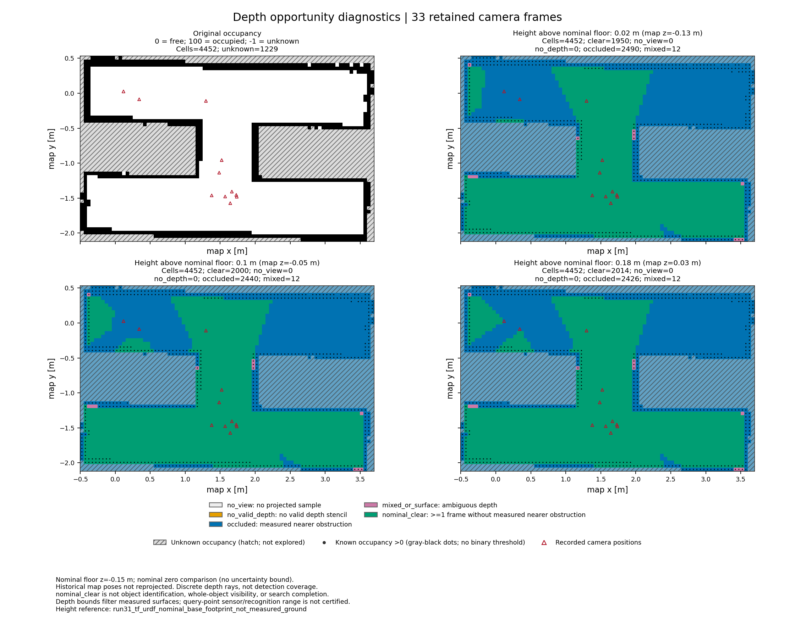

# run31 留存深度的离线诊断

2026-11-03。只读取已经关闭的 run31 留存输入，没有启动新的 ROS/仿真，也没有改写原任务。33/33 帧纳入、0 帧排除；每层保留完整 4452 格，三层共 440748 次帧—点分类。输入指纹重新核对通过，新增 44 项单元测试通过。



原地图自由格共 2584 个，在名义地面以上 0.02/0.10/0.18 m 三层中，分别有 **798/757/743 格没有名义 clear 支持**。绿色只表示至少一帧的四个离散深度样本在该格心之后；蓝色表示有遮挡支持且没有 clear/混合支持，其余帧仍可能在相机后方或图像外。未知地图格保持斜线，原 1229 个 unknown 未被删去或改成自由格。上方走廊存在需要补充观察的区域，详见 [缺口分析](run31-visibility-gaps.md)。

这不是识别覆盖率：深度/姿态/名义地面的误差没有标定，历史 TF 未通过最终 SLAM 优化重投影，查询点量程与整物体可见性未认证。33 帧来自相邻停车采样，不是独立可靠性试验。原任务 `visual_coverage_complete=false`、`mission_success=false` 保留。

## 文件与复算

- `report.json`：统计、假设、原任务标志及输出哈希。
- `inputs.json`：202 个原输入的指纹、原/当前审计、接受身份、实际计算源码的指纹。
- `layers.json.gz`：完整原始地图、格心状态、每格每帧的状态/查询范围支持索引及最有利余量；不是原图替代品。
- `sources/`：参与计算/审计的源码原字节副本，以 `.txt` 保存；源码指纹以 `inputs.json` 为准。
- `run31-visibility-review.md`：计算前的高度参考/聚合审查，不能当作计算结果。
- `validation.json`：44 项测试的工具结果摘要、整批输入/源码/产物重哈希及支持索引守恒检查。
- `provenance.json`：实际命令参数与源实验绑定；`base_git_commit` 是新工具提交前的基线，不冒充运行源码 commit。
- `SHA256SUMS`：本归档各文件的原字节 SHA256。

用 [离线工具说明](../../docs/depth-visibility.md) 中的命令复算，输出目录必须换成不存在的新目录。原始 RGB-D 没有提交 Git，复算需取得 `inputs.json` 指定且哈希一致的原始 run31 留存目录。绘图另外需要 numpy/matplotlib；读取/计算不依赖 ROS。当前渲染环境为 WSL `/usr/bin/python3`、numpy 1.26.4、matplotlib 3.6.3。

归档校验（WSL，仓库根目录）：

```bash
cd experiments/run31-visibility
sha256sum -c SHA256SUMS
```
